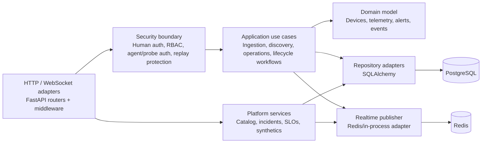
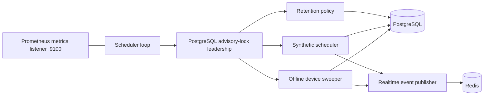
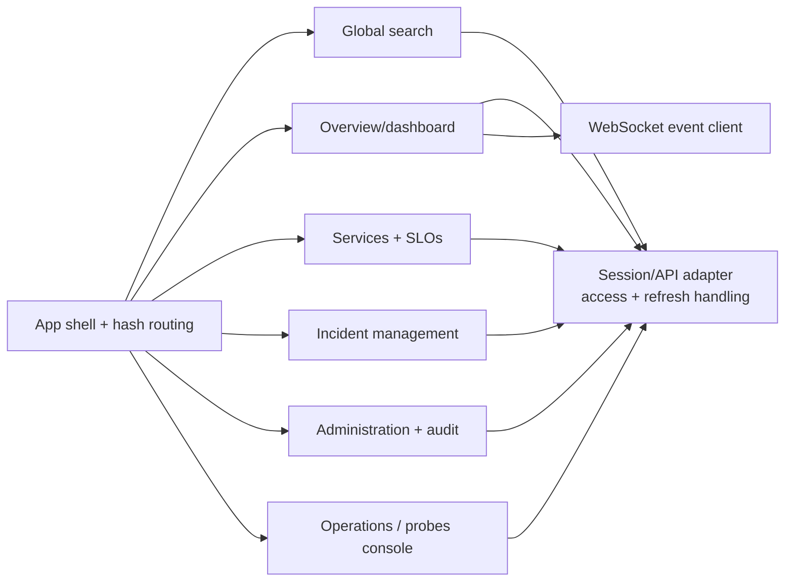
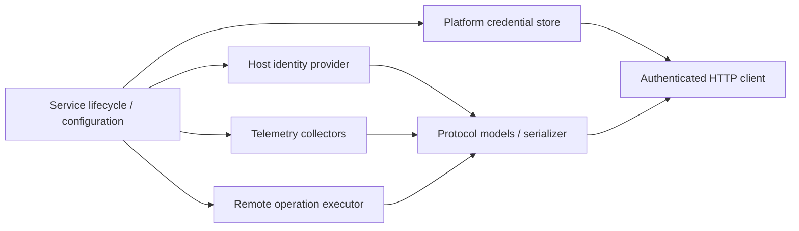
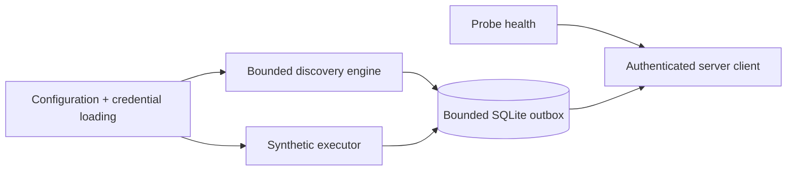

# C4 Level 3 — Component Diagrams

These diagrams document the internal component boundaries that matter operationally. They intentionally describe stable responsibilities and dependencies rather than individual classes.

## Backend API

### Backend component responsibilities

| Component | Responsibility |
|---|---|
| API routers | HTTP validation/serialization, dependency injection and protocol-specific status handling. |
| Request/mutation middleware | Request IDs, metrics, safe structured access logs and global audit coverage for authenticated mutations. |
| Human security | Argon2id credentials, roles, access/refresh sessions, revocation and user administration. |
| Machine security | Enrollment, per-agent/probe credentials, timestamp/nonce validation and replay prevention. |
| Application use cases | Coordinate domain behaviour without owning persistence technology. |
| Domain | Device/telemetry/event/alert concepts and rules independent of FastAPI/SQLAlchemy. |
| Platform repositories/services | Services/groups/dependencies, incident workflow/correlation, SLO/error budgets and synthetic state. |
| SQL repositories | Persist durable state and implement concurrency/transaction boundaries. |
| Realtime publisher | Decouple persisted events from WebSocket delivery and support multiple API replicas through Redis. |

## Scheduler worker

The worker contains no durable scheduler lease in memory. Leadership belongs to the PostgreSQL session, so process/session loss releases the lock and allows a standby to take over.

## Web application

The web application stores human access/refresh tokens in browser session storage, retries one failed request through refresh, and returns to the login route when refresh cannot restore the session.

## Host agents

Windows, Linux and macOS use platform-native implementations but share the same protocol-v1 responsibilities: stable identity, heartbeat, telemetry and only explicitly supported declarative operations. Compatibility policy is published by the backend under `/api/v1/system/version`.

## Distributed probe

The probe deliberately separates network execution from server delivery. Temporary server/network failure therefore queues bounded local results rather than allowing unbounded memory/disk growth.

## Dependency direction

The backend follows the architectural rule `adapters → application/domain ← infrastructure adapters`. Domain/application code must not import FastAPI-specific presentation concerns. Runtime infrastructure (PostgreSQL, Redis, Prometheus/Grafana) remains replaceable at explicit adapter boundaries rather than leaking into domain objects.
