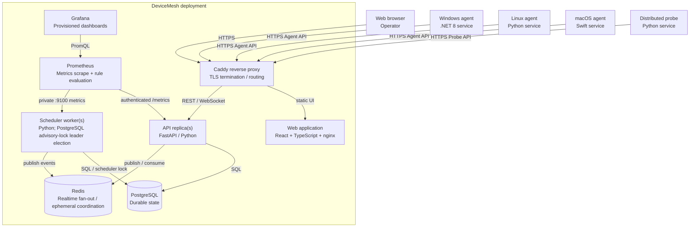

# C4 Level 2 — Container Diagram

This view describes the production-capable runtime containers and their communication paths. Mobile and ESP32 clients are shown only as future/external clients because they are not yet production-capable.

## Container responsibilities

| Container | Technology | Responsibility | Durable state |
|---|---|---|---|
| Reverse proxy | Caddy | Public HTTPS entrypoint, certificate handling and routing to web/API. | Certificate/config volumes only. |
| Web | React, TypeScript, nginx | Operator navigation, inventory, services, incidents, administration, audit and operations UI. | None; browser session state only. |
| API | FastAPI, Python | Human and machine APIs, auth/RBAC, ingestion, queries, mutation audit and WebSocket fan-out. | PostgreSQL via repositories. |
| Scheduler worker | Python | Offline detection, synthetic scheduling and retention jobs. Multiple instances may run; one owns the PostgreSQL advisory lock. | PostgreSQL; no authoritative local state. |
| PostgreSQL | PostgreSQL 16 | Authoritative application state: inventory, telemetry, events, auth, incidents, SLOs, audit and operations. | Yes. |
| Redis | Redis 7 | Cross-API realtime event fan-out and ephemeral coordination. Loss must not destroy durable product state. | No authoritative state. |
| Prometheus | Prometheus | Scrapes API/worker metrics, stores operational time series and evaluates DeviceMesh platform-health rules. | Local TSDB volume. |
| Grafana | Grafana | Presents provisioned DeviceMesh Overview and Workers/Synthetics dashboards. | Local configuration/dashboard state volume. |
| Windows agent | .NET 8 | Host identity/telemetry, authenticated publishing and declarative remote operations. | Credential/local runtime state only. |
| Linux agent | Python 3.12 | Linux host telemetry, identity and authenticated agent protocol. | Credential/local runtime state only. |
| macOS agent | Swift | macOS host telemetry, identity, credential storage and supported operations. | Keychain/local runtime state only. |
| Distributed probe | Python 3.12 | Bounded discovery, synthetic execution, health and offline outbox. | Bounded SQLite outbox and credential material. |

## Primary protocols

- Browser ↔ proxy: HTTPS; WebSocket for event streaming.
- Agents/probes ↔ API: HTTPS JSON with independent machine credentials, timestamps and replay protection.
- API/worker ↔ PostgreSQL: SQLAlchemy/psycopg.
- API/worker ↔ Redis: shared realtime event backend.
- Prometheus ↔ API: authenticated HTTP scrape; Prometheus ↔ worker uses the private Compose network.
- Grafana ↔ Prometheus: PromQL over the internal network.

## Scaling boundary

API instances are stateless at the application tier and can scale horizontally behind a load balancer. Scheduler workers may also have multiple replicas, but exactly one scheduler leader executes leader-owned jobs. PostgreSQL, Redis, the reverse proxy and storage require their own redundancy strategy when end-to-end HA is required.
