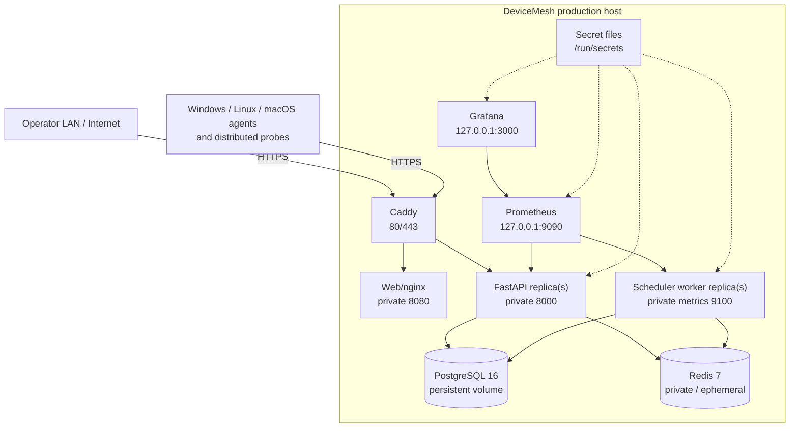

# C4 Deployment View

The supported production reference deployment is Docker Compose on a Linux host, NAS or server. The application tier is designed so API and worker processes can be replicated, while PostgreSQL/Redis HA remains an operator infrastructure responsibility.

## Security zones

| Zone | Exposure |
|---|---|
| Public/edge | Only Caddy ports 80/443 are intended for remote access. |
| Operator-local observability | Prometheus and Grafana bind to loopback by default; remote access should use SSH tunnelling or an authenticated proxy. |
| Application network | API, web, worker, PostgreSQL and Redis communicate on the private Compose network. |
| Secrets | Database URLs, operator bootstrap credential material and Grafana credentials are mounted as files rather than committed or placed in command lines. |

## Persistence

- PostgreSQL volume: authoritative DeviceMesh state. Backups and restore tests are mandatory before upgrades.
- Prometheus volume: platform telemetry; losing it affects historical operational graphs but not DeviceMesh business state.
- Grafana volume: local Grafana state; provisioned datasources/dashboards also live in source control.
- Caddy volumes: TLS certificates and proxy state.
- Redis: deliberately configured without authoritative persistence in the reference stack.

## Scaling and failover

### API replicas

API processes are stateless with respect to durable state. Multiple replicas can share PostgreSQL and Redis behind an external/reverse-proxy load-balancer. Realtime events use Redis rather than process-local state so the producer and browser-connected API instance can differ.

### Worker replicas

Multiple scheduler workers may run. PostgreSQL advisory lock `684291017` elects exactly one scheduler leader for offline sweeps, synthetics and retention. A dead process/database session releases leadership automatically so a standby can acquire it.

### Infrastructure dependencies

The reference Compose file uses single PostgreSQL, Redis and reverse-proxy instances. End-to-end HA therefore requires operator-supplied redundant PostgreSQL/Redis/proxy/storage/DNS infrastructure. DeviceMesh does not label the single-host reference stack as fully highly available.

## Deployment lifecycle

1. Generate/validate production configuration and secret files.
2. Build/pull pinned DeviceMesh artifacts.
3. Run the migration container with the migration database role.
4. Start API, worker and web services; wait for health/readiness.
5. Start bundled Prometheus/Grafana when self-observability is enabled.
6. Start Caddy and verify HTTPS from the intended client network.
7. Run the acceptance smoke test and verify backups before considering the deployment ready.

`production-acceptance.yml` currently exercises the production Compose services, migrations, authenticated ingestion/realtime behaviour, Prometheus/Grafana provisioning, backup restore and restart persistence in CI. A separate real-host HTTPS acceptance remains the final deployment-specific check because public DNS/certificate issuance cannot be meaningfully certified inside the isolated CI runner.
