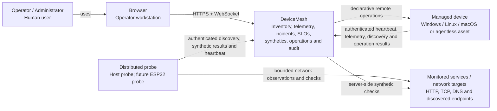

# C4 Level 1 — System Context

DeviceMesh is a local-first observability and operations platform for managed devices, discovered network assets, services and synthetic checks. Core operation does not require a third-party cloud service.

## People and systems

| Element | Relationship to DeviceMesh | Trust boundary |
|---|---|---|
| Operator / administrator | Uses the web application to observe fleet state, manage services/SLOs/incidents/users and queue permitted operations. | Human authentication, RBAC and audit apply. |
| Managed device | Reports identity and telemetry through a DeviceMesh agent, or appears through discovery when agentless. | Agent credentials are separate from human credentials. |
| Distributed probe | Executes bounded discovery and synthetic work assigned by the server and reports results. | Probe bearer credentials are independently rotatable/revocable. |
| Monitored target | A service, endpoint or device checked by server/probe synthetics. | Treated as external/untrusted input. |
| Browser | Hosts the React operator application. | Receives short-lived human session state; never receives agent/probe secrets. |

## System responsibilities

DeviceMesh owns durable inventory, telemetry history, alert/incident state, service modelling, SLO/error-budget reporting, audit history, synthetic definitions/results and remote-operation state. It also exposes operator APIs, machine-ingestion APIs, realtime WebSocket events and Prometheus metrics.

## External dependencies

PostgreSQL and Redis are runtime infrastructure dependencies but are not separate business systems. PostgreSQL is the durable system of record; Redis is ephemeral coordination/realtime infrastructure. Optional future integrations such as OIDC/LDAP, notification providers or external observability backends must remain behind explicit adapters.

## Out of scope at this level

Mobile applications and ESP32 firmware remain separate clients/scaffolds until their production contracts are implemented. Kubernetes is intentionally deferred; the current production reference deployment is container-based.
