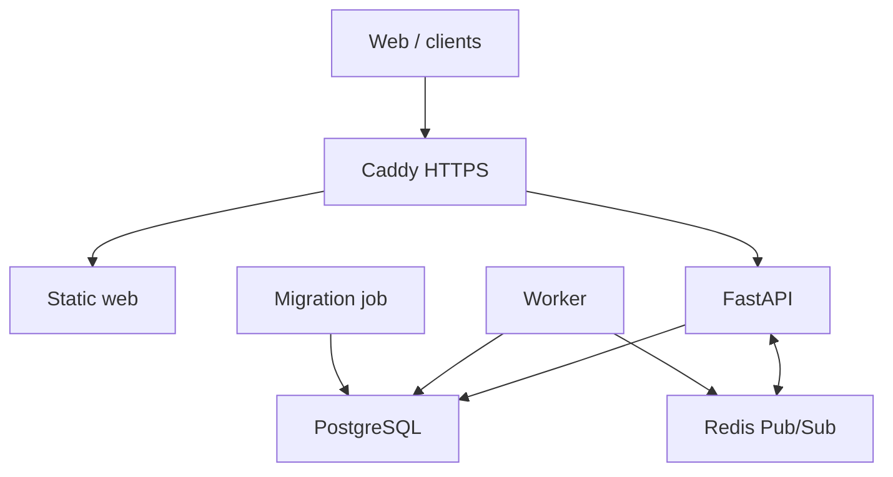

# Production deployment candidate

This deployment is a candidate until the clean-host, HTTPS, restore and scale acceptance gates pass. The full proposal and remaining work are tracked in [the 57-point implementation ledger](../product/IMPLEMENTATION_57_POINTS.md).

## Install on a Linux host

Prerequisites: Docker Engine with Compose v2 supporting `--wait`, Bash, Python 3, curl, a DNS hostname pointing to the host, and inbound TCP 80/443. PostgreSQL and Redis are not published to host ports. Use a clean database volume for the first install; do not attach an existing development database volume without a migration rehearsal.

```bash
git clone https://github.com/DavidEgeaCalatayud/DeviceMesh.git /opt/devicemesh
cd /opt/devicemesh
# Check out the reviewed release/commit containing these scripts first.
cp .env.production.example .env.production
# Set DEVICEMESH_DOMAIN and matching HTTPS CORS origin; use an explicit image tag.
tools/deployment/install.sh
tools/deployment/compose.sh exec api python -m app.admin admin
```

The last command prompts for the initial administrator password. Sign in at your HTTPS hostname, then create Viewer/Operator accounts under Administration. `install.sh` validates configuration, generates unique secrets once, builds images, runs Alembic before writers start, and checks private API reads and HTTPS web delivery. It never executes `.env` as a shell script. Existing credentials are not silently rotated on reruns.

The secret directory must remain mode 0700. `tools/deployment/config.py --init-secrets`
also creates the dedicated `mobile_push_encryption` key used to encrypt FCM/APNs device tokens
at rest; upgrades add that file without rotating existing secrets. Compose grants containers only
their selected secret files. Those files are readable by the application's non-root container UID, while the host parent directory prevents traversal by other host users. PostgreSQL's owner credential is reserved for initialization/migration/backup; the API and worker use a role with DML grants and no schema ownership. Operators with Docker access remain fully trusted administrators.

The bootstrap operator token remains an emergency administrator credential: protect it and use individual accounts day to day. Session access tokens last one hour by default, rotating refresh tokens seven days. Disabling a user revokes their sessions. Login throttling is persisted by username and source IP; behind the bundled proxy the IP bucket may represent the proxy, so accounts also have independent limits. Do not trust arbitrary forwarded IP headers.

## Process and network layout



Redis events are best effort realtime invalidations. PostgreSQL is the durable timeline; reconnecting dashboards refresh their HTTP snapshots. Production disables embedded API workers. The independent worker holds a PostgreSQL advisory lock to elect one scheduler, retries job failures and handles SIGTERM. Multi-instance failover and network partition behavior still require a dedicated acceptance run. Never scale the development stack's embedded workers as a production HA setup.

## Upgrade and rollback

Keep the current commit/image tag, `.env.production`, secret directory and a verified backup. Review the target release migration notes and check out its code, then run:

```bash
tools/deployment/upgrade.sh
```

This builds images, takes a backup, stops writers, migrates, starts services and runs smoke checks. On failure the command exits; it does not auto-downgrade or erase data. Restore using the target-compatible release and the explicit procedure in [BACKUP_RESTORE.md](BACKUP_RESTORE.md). A rollback after schema changes is a database restore plus the matching application version, not just a previous container tag. Do not reuse mutable `local` tags for published releases.

## Acceptance boundaries

`production-acceptance.yml` builds the production services, checks unauthorized reads, enrollment, heartbeat, Redis/WebSocket delivery, durable inventory, restart and a backup restored into an isolated database. CI exposes loopback-only test ports and omits public TLS. A real DNS/certificate/HTTPS smoke on a clean host is a separate release gate. Telemetry-to-alert/browser E2E, two-API fan-out, failure injection and 24-hour soak remain required before a production-ready claim.

The source bundle script (`python tools/release/bundle.py`) packages only a committed Git tree and adds SHA256SUMS and a commit manifest. It is a source/build bundle, not a published container image or signed MSI/mobile release. Python dependencies are locked with hashes and web builds use `npm ci`; container base-image digest pinning and signed provenance remain pending.
